# Electric Guitar Simulation (MATLAB)

A six-string electric guitar simulation built from the one-dimensional wave equation. The model uses finite differences and Symplectic Euler integration to simulate plucked strings, fret changes, and damping, then approximates an electromagnetic pickup and applies amplification, low-pass filtering, and distortion. The project also examines how numerical resolution and audio-processing choices affect the resulting waveform and sound.

## Physical and numerical model

For a string with displacement $H(x,t)$, tension $T$, and mass per unit length $M$, the small-displacement wave equation is

$$
M\frac{\partial^2 H}{\partial t^2}=T\frac{\partial^2 H}{\partial x^2},
\qquad H(0,t)=H(L,t)=0.
$$

The standing-wave frequencies of a fixed string are

$$
f_k=\frac{k}{2L}\sqrt{\frac{T}{M}},\qquad k=1,2,3,\ldots
$$

The simulation introduces damping through the spatial curvature of velocity $V=\partial H/\partial t$:

$$
\frac{\partial V}{\partial t}=\frac{T}{M}\frac{\partial^2 H}{\partial x^2}
+\frac{R}{M}\frac{\partial^2 V}{\partial x^2},
\qquad \frac{\partial H}{\partial t}=V.
$$

With spatial spacing $\Delta x$ and timestep $\Delta t$, the program updates the velocity first, then displacement (Symplectic Euler):

$$
V_j^{n+1}=V_j^n+\frac{\Delta t}{M(\Delta x)^2}
\left[T(H_{j+1}^n-2H_j^n+H_{j-1}^n)
+R(V_{j+1}^n-2V_j^n+V_{j-1}^n)\right],
$$

$$
H_j^{n+1}=H_j^n+\Delta t\,V_j^{n+1}.
$$

This allows string motion to be calculated directly from neighboring grid points rather than constructing an explicit sum of harmonics.

### Guitar mechanics and signal processing

- **Strings:** Six strings in standard tuning (E2–A2–D3–G3–B3–E4). Tension is calculated from each string's fundamental frequency, gauge, assumed uniform density, and $L=0.62865\ \mathrm{m}$ scale length.
- **Frets:** The $n$th fret is placed at $x_n=L(1-2^{-n/12})$. Grid points between the nut and the held fret are fixed, shortening the vibrating length and raising the pitch by semitones.
- **Plucking:** Each note resets its string to a triangular displacement profile with zero initial velocity.
- **Pickup:** A weighted velocity sample near the pickup ($0.2,\ 0.6,\ 0.2$ over three neighboring grid points) approximates the induced signal; contributions from all six strings are summed.
- **Effects:** The signal passes through gain, a one-pole low-pass filter, and soft-clipping distortion:

$$
S_{\mathrm{amp}}[n]=G\,S_{\mathrm{pickup}}[n],
\qquad
S_{\mathrm{LPF}}[n]=\alpha S_{\mathrm{amp}}[n]+(1-\alpha)S_{\mathrm{LPF}}[n-1],
$$

$$
S_{\mathrm{final}}[n]=\tanh\!\left(d\,S_{\mathrm{LPF}}[n]\right).
$$

The supplied script uses $G=12$, $\alpha=0.20$, $d=2.2$, a bridge-side pickup at $0.92L$, and $121$ spatial grid points per string. The final signal is normalized for playback and saved at **8,192 samples/second**.

## Results and figures

The following images are taken from the project writeup. Some show experimental settings or musical passages different from the default progression in `Electric_guitar_simulation.m`.

### Filtering and distortion

| Clean pickup | After low-pass filtering |
|:--:|:--:|
| 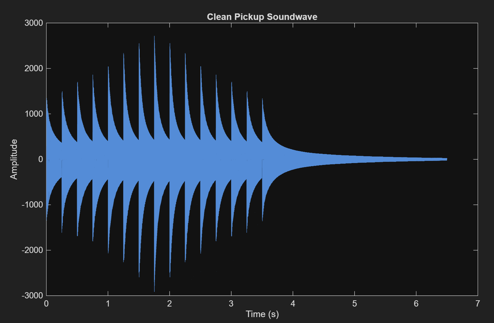 | 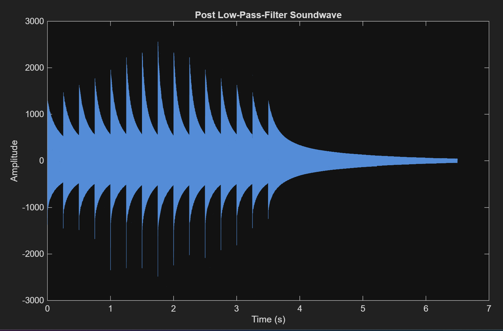 |

The clean signal contains sharper, high-frequency fluctuations. Low-pass filtering smooths the waveform and reduces higher-frequency contributions while largely retaining its overall envelope.

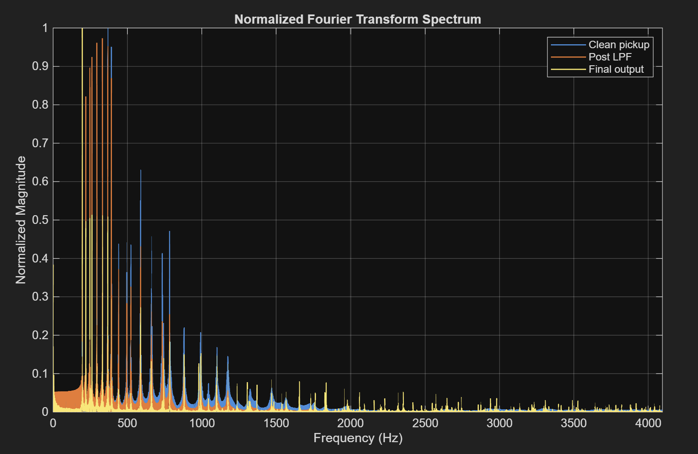

**Frequency-domain comparison:** The FFT plot compares independently normalized spectra of the clean pickup, post-filter, and distorted signals. Filtering attenuates many high-frequency peaks; nonlinear clipping produces additional harmonics and redistributes spectral magnitude. Because each spectrum is normalized, peak heights describe **relative spectral content**, not absolute signal energy.

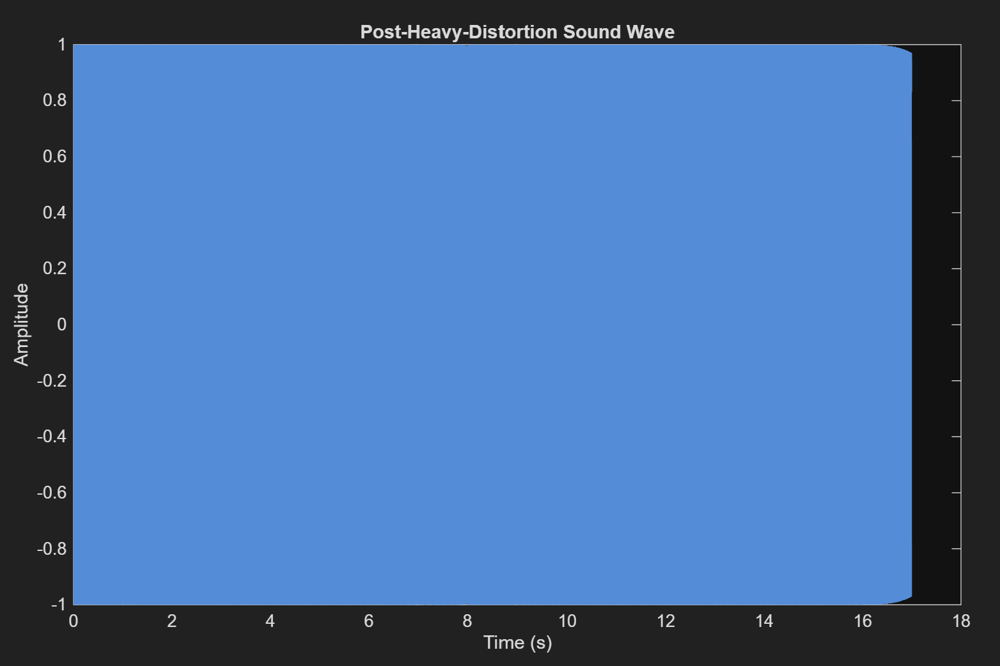

**Heavy distortion:** Strong clipping pushes much of the signal toward $-1$ and $+1$, flattening the amplitude envelope and producing a more saturated, less distinctly plucked sound.

### Numerical sensitivity

For the damped finite-difference scheme, the timestep must satisfy

$$
\frac{T(\Delta t)^2}{M(\Delta x)^2}
+\frac{2R\Delta t}{M(\Delta x)^2}\leq 1,
$$

or equivalently

$$
\Delta t\leq -\frac{R}{T}
+\sqrt{\left(\frac{R}{T}\right)^2+\frac{M(\Delta x)^2}{T}}.
$$

The code chooses a timestep below the minimum stability limit across all six strings, then adjusts it to align with the 8,192 Hz audio sample rate.

| Fine spatial grid (800 points) | Coarse spatial grid (30 points) |
|:--:|:--:|
| 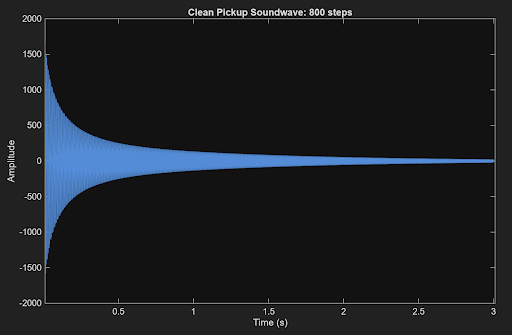 | 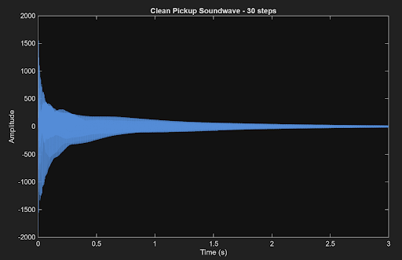 |

**Spatial resolution:** The 800-point and 30-point experiments retain a broadly similar note and decay envelope. The coarser grid introduces visible waveform differences and small pitch deviations (about 2–3 cents across the resolution tests reported in the writeup).

| At the timestep limit | Beyond the timestep limit |
|:--:|:--:|
| 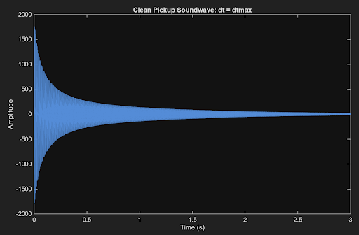 | 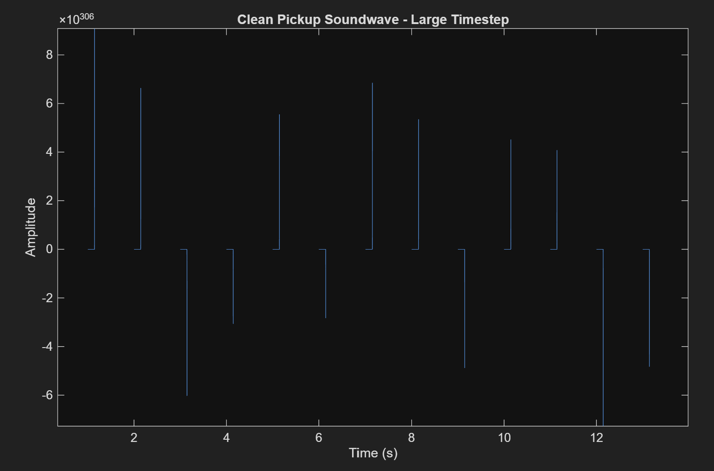 |

**Stability:** The waveform remains bounded at the calculated timestep limit, but at approximately $1.1\Delta t_{\max}$ the numerical solution diverges, producing extreme spikes instead of a sustained musical tone.

### Pickup location and effect order

| Bridge pickup | Neck pickup |
|:--:|:--:|
| 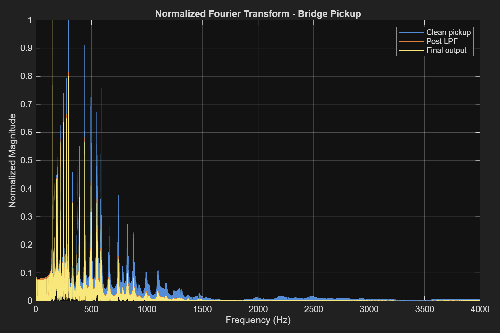 | 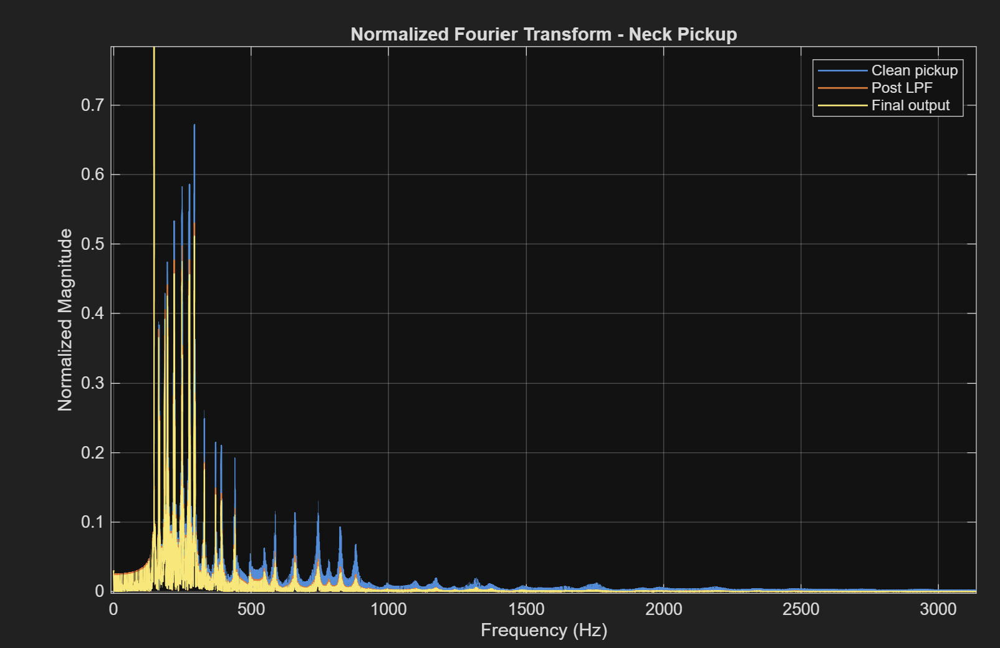 |

Moving the pickup toward the neck reduces the relative strength of several upper harmonics, producing a rounder timbre than the bridge pickup in the comparison recordings.

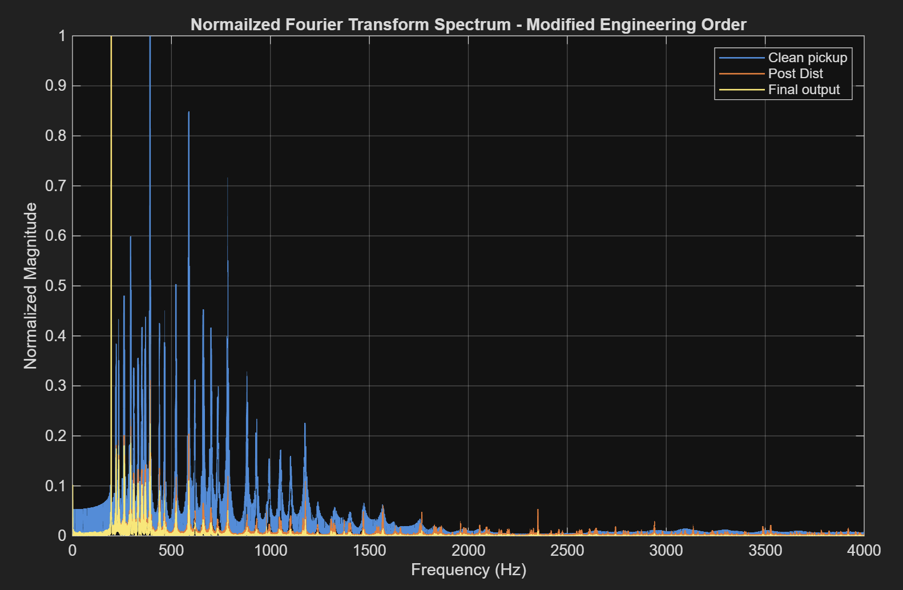

**Effect order:** Applying distortion *before* the low-pass filter removes some of the high-frequency content that clipping creates. This differs from the default script, which filters **before** distortion.

| Soft clipping | Hard clipping |
|:--:|:--:|
| 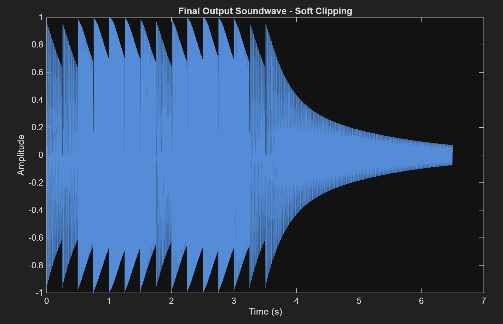 | 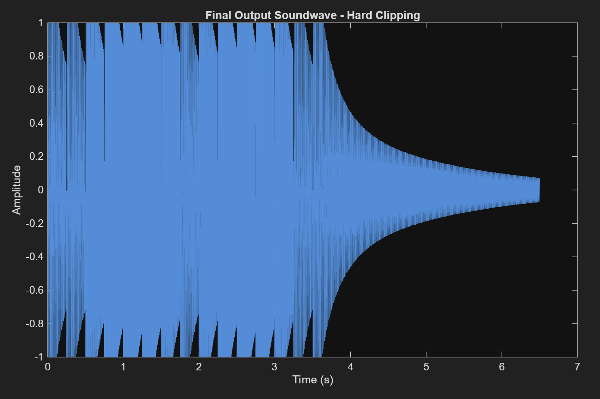 |

**Clipping method:** Soft clipping with `tanh` rounds the peaks; hard clipping truncates them abruptly, giving the comparison recording a harsher sound. Hard clipping is examined in the writeup but is **not** the default implementation in the attached script.

## Listen to the experiments

Audio links embedded in the original writeup:

- **Signal processing:** [Clean G-major scale](https://drive.google.com/file/d/1Wfv9DsD_GGtCqMXXCO66ekPNHKpC63uM/view?usp=sharing) · [After low-pass filtering](https://drive.google.com/file/d/1-PiCjXzT8Hl79kwMvJcbcJv7YxtoZqXE/view?usp=sharing) · [Heavy distortion](https://drive.google.com/file/d/1mkLqp56Fnx1YyBtChBKwLhs1a--C7FYG/view?usp=sharing)
- **Stability:** [Increasing timestep / CFL test](https://drive.google.com/file/d/1pG1hmdDnpL2HltO5uSkh3NtXeLazinZg/view?usp=sharing)
- **Pickup position:** [Bridge](https://drive.google.com/file/d/1apKdgxc887bV8C4BIHugFiOE3HdrTojn/view?usp=share_link) · [Neck](https://drive.google.com/file/d/1wMtrzL90AqjWhCO9VgjwDDylmyrh86St/view?usp=share_link)
- **Clipping:** [Soft clipping](https://drive.google.com/file/d/1oI7HflSNOyjJYSzhmBbfH8q_TbtJUUq7/view?usp=share_link) · [Hard clipping](https://drive.google.com/file/d/1AzaqPR2dr0ya1wRSLtQidDSttvl5o7AV/view?usp=share_link)
- **Riff demonstrations:** [Mr. Brightside](https://drive.google.com/file/d/1zyA8TdwSqXwiW99YQvWroTQKr4HgMch6/view?usp=sharing) · [Smoke on the Water](https://drive.google.com/file/d/12PJ2udaFo32vz-6TLa9Dl7qR6WvTlB8x/view?usp=sharing)

*Audio availability depends on the Google Drive sharing permissions of the original files.*

## Running the MATLAB simulation

1. Open `Electric_guitar_simulation.m` in MATLAB and run it. No external data files are required.
2. Edit `tnote`, `anote`, `inote`, and `fnote` at the beginning of the script to change note timing, pluck strength, string, and fret. The supplied version contains an example progression with individual notes and simultaneous two-string notes.
3. Adjust pickup location and audio settings (`pickupFrac`, `gain`, `toneAlpha`, `distDrive`) to test different sounds.

The script plays the processed output, displays **three amplitude-versus-time plots** and **one FFT comparison**, and writes the following WAV files to the current MATLAB working directory:

```text
clean_pickup.wav
post_LPF.wav
final.wav
```

The experimental plots above come from additional runs described in the report; the single script does not automatically recreate every comparison. The model also approximates strings and pickups rather than modeling their complete mechanical and electromagnetic behavior.

## References

- [C. Peskin, *Computer Simulation of Stringed Instruments*](https://math.nyu.edu/~peskin/ics_lecture_notes/string.pdf) — reference for the string discretization and integration scheme.
- [MathWorks, *Fourier Transforms*](https://www.mathworks.com/help/matlab/math/fourier-transforms.html) — FFT analysis.
- [Curt Mangan, Guitar String Tension Chart](https://curtmangan.com/guitar-string-tension-chart/) — string parameter reference.
- [Yamaha, *What Are Pickups?*](https://www.yamaha.com/en/musical_instrument_guide/electric_guitar/mechanism/mechanism002.html) — pickup operation.
